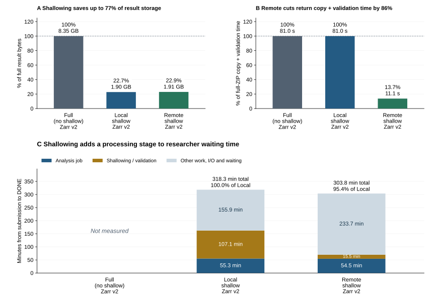

# Working with shallow OME-Zarr results

```{raw} html
<style>
.wy-nav-content { max-width: 1100px; }
.wy-table-responsive table { width: 100%; table-layout: fixed; }
.wy-table-responsive table td, .wy-table-responsive table th { white-space: normal; }
.wy-table-responsive code { overflow-wrap: anywhere; }
</style>
```

BIOMERO stores a workflow result as **retained data plus references to unchanged
managed pixels**. The result remains a distinct OMERO Image or Plate with its
own provenance. Storage is saved on the shared filesystem, without deleting the
source or suppressing result registration.

## On disk: shallow off versus on

**Example: one 2D v2 Image, unchanged intensities, one new `cells` label.**
The directory contents below represent the same analysis result.
**The two comparisons use grey borders for Shallow OFF and purple for Shallow
ON.** Here, fills describe contents: blue pixels, green labels, yellow
reference/provenance metadata.

```{raw} html
:file: ../_includes/shallow-file-trees.html
```

**The blue folders disappear from the result:** full-resolution image
chunks and their pyramid arrays. The original source retains those pixels.
**Green is added by the workflow, not by the shallower:** those label files
remain in both result formats. Two small JSON files are added; `.zattrs` loses
`multiscales` and gains a `biomero` pointer to the shallow manifest.
These edits affect the returned image metadata; the source is unchanged by
shallowing. Other output files, such as CSV measurements, remain.

The file `0.0` is an example pixel chunk; `…` stands for further chunk files.
Blank rows on the right align the retained labels; they are not files.
This is a file-layout example, not a file-count or size scale. `0`, `1`, ... are
example array names; `s0`, `s1`, ... work too. A Plate repeats the image layout
under its well/field paths. V3 uses `zarr.json` in place of the v2 metadata files;
the same keep/omit/reference distinction applies.

## In OMERO: two different references

```{mermaid} ../_diagrams/shallow-references.mmd
```

The importer creates a new result Image or Plate in both cases. With shallow
storage on, it registers the **source pixel path** for primary intensities and
adds a **`biomero.zarr.shallow` MapAnnotation** locating the shallow result and
its references. The viewer and later transfers use that result reference to
find labels and reconstruct the collection.

**PixelBuffer does not need to interpret the shallow manifest:** it reads the
source path already registered by the importer. Label-backed mask Images and
the optional Plate preview similarly register their retained label paths.
{ref}`Preview controls <plate-mask-preview>`.

The two JSON files have separate jobs:

| File | Purpose |
| --- | --- |
| `.biomero-shallow.json` | Which image/label nodes exist, which arrays were omitted, and their source storage roots, paths, generations and identities |
| `.biomero-shallow-report.json` | Decision, input snapshot and tool provenance; remote receipts bind this report to the expected helper run |

Source indexing is separate: canonical-source annotations
(`biomero.zarr.source` / `biomero.zarr.plate-source`) record the reusable input.
Indexing can also add a `.biomero-canonical.json` marker to the source store;
this is metadata, not another pixel copy.
**Keep the source, retained labels and their references together in retention
and backup policy.** The shallow folder alone is incomplete.

## Workflow input: reuse, reconstruct or export

The workflow receives full input in its requested format. It does not resolve
BIOMERO shallow references itself.

```{mermaid} ../_diagrams/shallow-workflow-input.mmd
```

**Reconstruction** assembles a temporary full Zarr from the source and all
retained/referenced labels. **Export** reads the selected OMERO pixel view; it
does not reconstruct the shallow result's full label collection. A format
mismatch uses export and leaves the original canonical registration unchanged.

### What registering or promoting a canonical Zarr entails

A **canonical Zarr** is the stable managed pixel source and identity record used
to compare later workflow results. Establishing it runs during input transfer
when shallow storage is enabled and an eligible canonical record is missing.
Yellow steps below mark ISCC-BIO pixel reads.

```{mermaid} ../_diagrams/shallow-canonical.mmd
```

| Starting point | Pixel calculation | What canonical registration changes |
| --- | --- | --- |
| Existing authoritative backing Zarr | ISCC-BIO reads that store directly; per-image/field and label identities | Adds the marker and OMERO source records in place; no new pixel copy |
| Eligible fresh OMERO export | ISCC-BIO compares OMERO pixels with exported pixels | Commits the verified export to stable managed canonical storage and attaches source records |
| Valid canonical already registered | Reuses cached identities for that generation | Records the workflow's input snapshot; no repeated source hash |

Only the matching generation is reused. A temporary format-mismatch export or
TIFF conversion input is not promoted. Failed indexing/promotion leaves the
full workflow input usable without deduplication for that selection. Missing
dependencies of a shallow input must be resolved before it can be reconstructed.
Returned pixels are calculated again at the return-side comparison shown above.

## When verification runs

| Route | Order |
| --- | --- |
| Shallow off | Workflow → full ZIP → transfer → full result registration |
| Shallow on, remote | Workflow → HPC verification/pruning → smaller ZIP → transfer → receipt validation → registration |
| Shallow on, local | Workflow → full ZIP → transfer → importer verification/pruning → registration |

| Responsibility | Implementation |
| --- | --- |
| Pixel traversal and codes | [bio-codes / ISCC-BIO](https://github.com/bio-codes/iscc-bio), through `iscc_bio.api.biocode`; IMAGEWALK reads decoded highest-resolution pixels per image/field or label |
| Equality decision | BIOMERO compares `instanceCode`, role, shape, dtype, axes and coordinate transformations |
| Storage, transactions and references | BIOMERO.shallower; shared contracts from biomero-schema |
| HPC orchestration and OMERO registration | BIOMERO core/scripts and BIOMERO.importer, respectively |

The aggregate ISCC and similarity-oriented Data-Code are recorded but **do not
authorize removal**. A checksum of the complete Zarr file tree is not an
equality key. Returned identities are computed from pixels rather than trusted
from workflow metadata. See the [exact comparison contract](https://nl-bioimaging.github.io/biomero-schema/pixel-identity/).

Highest-resolution equality is the preservation criterion: lower-resolution
pyramids are reused from the source, not independently compared. This preserves
the scientific pixel representation checked by the method, rather than every
byte or pyramid rendering of the returned store.

| Condition | Action |
| --- | --- |
| Shallow storage disabled; ordinary upload; TIFF result | No shallow operation |
| Input/output Zarr profiles differ | Keep full; check format metadata before pixel hashing |
| Eligible collection with matching image identities | Omit duplicate image pyramids; reference matching inherited labels; retain new/changed labels |
| Changed image, unsupported identity, incomplete or ambiguous match | Keep the full collection |
| Invalid receipt, missing referenced source or unresolved transaction | Stop and preserve evidence for recovery; absent pixels cannot be treated as a full result |

Pruning uses same-filesystem moves and a rollback journal before committing the
manifest. Source pixels remain untouched. See [configuration and recovery](../sysadmin/remote-shallower.rst).

## Results: measured benefits and limits

[](../_static/figures/shallow-results.svg)

**Historical 846-image comparison; lower is better in every panel.**
Categories have the same order throughout. A uses the full archive's uncompressed
file bytes as 100%; both Full and retained results include measurements and
metadata, excluding shared source data. B uses the full ZIP's measured HPC return copy plus archive
validation time as 100%; Local transfers that full ZIP before shallowing.
This is the combined copy/validation stage, not isolated network throughput.
C stacks the
measured analysis and shallowing stages with the remaining work to show total
submission-to-DONE time. Total percentages use Local = 100%.
**No separate Full run was timed at this scale.** GB is decimal.
The reductions in the headings are observations from this comparison.

| Time breakdown | Local shallow | Remote shallow |
| --- | --- | --- |
| Analysis job | 55.3 min | 54.5 min |
| Return-side shallowing / validation | 107.1 min | 15.5 min |
| Other work, I/O and waiting | 155.9 min | 233.7 min |
| **Total researcher wait** | **318.3 min** | **303.8 min** |

Remote retained **1.91 GB** instead of **8.35 GB**, avoiding approximately
**6.44 GB per result (77.1%)**; its return ZIP was **87.6% smaller**. Measured return
copy plus validation fell from **81.0 s to 11.1 s**
(**86.3%, or 69.9 s saved**) in this pair. Shallowing is
**part of total wait**, not extra time to add to that total. Its stage fell by
91.6 min, but other work increased by 77.8 min. Permanent archive staging alone
took 115.7 min locally versus 190.1 min remotely under variable storage load.
Total wait therefore fell by only **14.6 min (4.6%)**.

These are stage costs, not measured net overhead versus Full. Subtracting them
does not predict a shallow-off runtime: archive sizes and I/O would also change.

The input identities were cached for both runs. Fresh source indexing took
**34.6 min** separately and is excluded above. Storage excludes the shared source;
the remote helper additionally reserved **0.482 CPU-hours**, with no GPU.
This is one matched pair, not a new benchmark of the current release.
[Measurement context](../sysadmin/remote-shallower.rst).
Reproduce the figure: [measurement data](../_figures/data/shallow-846-image.json),
[plotting script](../_figures/shallow_methods.py),
[instructions](../_figures/README.txt).

(reconstruct-shallow-zarr-on-disk)=
## Reuse, reconstruction and storage accounting

| Next use | Representation supplied |
| --- | --- |
| Same-format native Zarr workflow | Reconstructed full Zarr, including inherited and new labels |
| Different-format workflow | Normal export of selected OMERO pixels; inherited labels are not reconstructed and canonical matching is disabled for that run |
| TIFF workflow on a mask Image | Selected mask pixels through the existing v2-to-TIFF route |
| External sharing | Explicitly reconstructed, self-contained Zarr |

V2 / OME-Zarr 0.4 and v3 / OME-Zarr 0.5 remain distinct profiles. Existing stores
keep their format; native workflows default to v2 and opt into v3 individually.
A shallow directory is a private BIOMERO representation, not standalone
OME-Zarr or an RFC 8 Collection.

The existing [standalone reconstruction recipe](https://github.com/NL-BioImaging/BIOMERO.shallower#reconstruct-a-full-zarr)
creates a full Image or Plate at a **new destination**, preserving its format
and leaving OMERO registrations unchanged. It needs all referenced stores and
enough free space. This is a materialized copy, not an in-place undo command.

Operation reports support optional `bytesBefore` / `bytesAfter` measurements
(`--benchmark-bytes` for standalone normalization). Normal runs omit these to
avoid extra filesystem scans. Where measured, **avoided result bytes = before
− after**; archive savings and allocated filesystem space require separate
measurements. A retrospective audit cannot report an exact original result size
when that measurement was never recorded.
